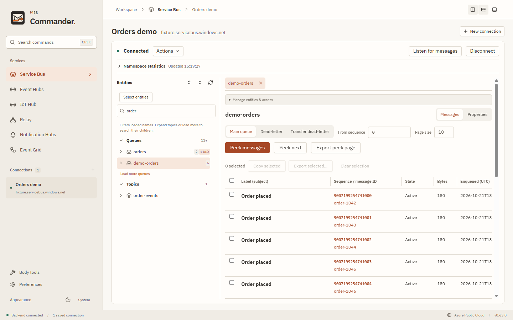
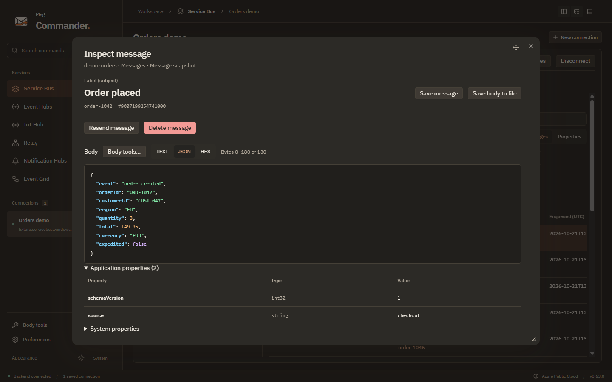

# Msg Commander

A desktop workspace for Azure messaging on macOS, Windows and Linux. Built with Electron, Vue 3 and a bundled .NET backend.



<details>
<summary>Message inspection in dark mode</summary>



</details>

Screenshots use synthetic messages in the offline demo host. [Refresh the screenshots](docs/development.md#readme-screenshots).

Installed releases support background update downloads and ask before restarting. Use **Preferences → Application updates → Check for updates** to check manually. See [releasing and automatic updates](docs/releasing.md) for supported packages, publishing and saved-connection preservation.

## What it does

- **Service Bus:** browse queues, topics and subscriptions; inspect messages; send, receive, settle, schedule and defer; work with sessions, dead letters, listeners and recovery.
- **Event Hubs:** inspect partitions and events, send batches, run bounded listeners, and save local checkpoints.
- **IoT Hub:** read device-to-cloud events through the Event Hubs-compatible endpoint, with local inspection and checkpoints. This connection is read-only.
- **Event Grid:** manage namespace HTTP topics and subscriptions, publish CloudEvents, and receive and settle events.
- **Notification Hubs:** manage hubs, registrations, provider credentials, configuration and test notifications.
- **Relay and Hybrid Connections:** manage resources and policies, import/export configuration, and test HTTP and stream connections.
- **Local tools:** message/event archives, raw body files, text encodings, GZip/Deflate, JSON/text/hex inspection, saved connections and preferences.

Mutating operations use explicit review and retained outcomes. Interrupted writes can have an uncertain result; inspect their receipts before trying again. Native Msg Commander formats are supported. Arbitrary message bodies remain data and are never executed.

## Run from source

Install Node.js 24 (the CI version; minimum 22.12) and the .NET 10 SDK, then run:

```sh
npm ci
node node_modules/electron/install.js
npm run dev
```

The explicit Electron install step downloads the desktop runtime, matching CI; repeat it after a clean dependency install. The desktop app launches its backend automatically. Azure credentials are only needed for the services you connect to. [Development](docs/development.md) covers the source layout, authentication and local workflow.

## Check and package

```sh
npm test
npm run build
npm run test:desktop
npm run format:check
npm run package
```

Packaging produces a self-contained backend for the selected platform. The [packaging guide](docs/packaging.md) lists supported targets and signing requirements. Docker and cloud checks are separate opt-in suites; see [testing](docs/testing.md) and the [emulator guide](tests/emulator/README.md).

The GitHub [desktop workflow](.github/workflows/desktop.yml) builds and checks native packages on macOS ARM64/x64, Linux x64 and Windows x64. A configured CI matrix does not substitute for completed native or live Azure qualification.

## Documentation

- [Features and operation boundaries](docs/features.md)
- [Architecture](docs/architecture.md)
- [Development](docs/development.md)
- [Testing](docs/testing.md)
- [Packaging](docs/packaging.md)
- [Releases and automatic updates](docs/releasing.md)
- [Local emulators and contract fixtures](tests/emulator/README.md)
- [Branding and workspace upgrades](docs/branding.md)
- [Contributing](CONTRIBUTING.md)

## License

[MIT](LICENSE). Dependency and bundled component notices are in [THIRD_PARTY_NOTICES.md](THIRD_PARTY_NOTICES.md).
