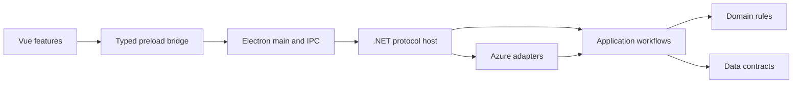

# Architecture

Msg Commander separates the desktop shell, typed contracts and messaging workflows. The renderer does not access Node.js, arbitrary files or provider credentials.

## Backend projects

- **Domain:** address validation, topology, supported settings and other business rules. No provider SDK references.
- **Contracts:** transport-neutral data records. Validation and workflow logic stay outside this project.
- **Application:** typed commands, operation state, bounded retention, cancellation and gateways. It references Domain and Contracts.
- **Infrastructure:** Azure SDK access and translation between service models and application contracts. It implements Application ports.
- **Host:** composition, request parsing, protocol error mapping and event forwarding. It references Application and Infrastructure.

`MsgCommander.TestHost` supplies offline adapters and direct boundary checks. It is excluded from packaged applications. Architecture tests enforce project references and keep provider types out of Host and workflow code.

## Desktop boundaries

`src/main` owns native dialogs, bounded file reads, atomic exports, saved workspace state and child-process lifecycle. Feature registrars use the shared IPC registration boundary. The typed channel map constrains argument and response types.

`src/preload` exposes the desktop API. Context isolation and sandboxing remain enabled, Node integration is disabled, and external navigation/window creation is denied. The packaged renderer uses the application protocol.

Renderer features access the bridge through typed feature API modules. Imports between features use public entry points and form an acyclic graph. Shared UI and workspace modules do not import feature implementations. Progress projections belong to the features that own the operations.

## Messaging semantics

Sequence numbers and other exact 64-bit values cross JSON as decimal strings. Original body bytes and typed properties remain available independently of their formatted previews.

Connection owners coordinate foreground operations, listeners and receiver disposal. Exclusive sessions and held deliveries remain scoped to the connection that acquired them. A reset invalidates stale snapshots and confirmations.

Write receipts distinguish confirmed success, definite rejection and uncertain outcomes. A lost acknowledgement is not treated as rejection and does not trigger an automatic retry. Duplicate operation IDs return retained receipts when the request fingerprint matches; altered requests are rejected. Cancellation after acknowledgement preserves the acknowledged outcome.

Event Hubs listener planning, execution and receipt retention have separate owners. Per-partition checkpoints are built from retained events. Service Bus and Event Grid settlement use opaque ownership handles rather than exposing SDK locks to the renderer.

## Files and workspace

Main selects local paths; the renderer receives bounded metadata and preview identifiers. Imports validate format/version, duplicate fields, sizes and typed values before offering drafts or changes. Configuration imports stage connection-bound plans and require explicit review before writes.

`workspace.json` stores preferences, connection metadata and encrypted credential fields. Electron's `safeStorage` encrypts remembered secrets; session-only secrets remain in memory. Startup and metadata reads do not decrypt credentials. Version-1 workspaces are read into the current version-2 model. Application upgrades preserve supported native workspace and file formats; see [branding and compatibility](branding.md).

## Application updates

The main process owns update checks through `ApplicationUpdates` and `electron-updater`. Before an accepted restart, it blocks new desktop requests, waits for pending requests, closes messaging connections, stops the backend and flushes workspace writes. The renderer can request a check but cannot choose an arbitrary update feed. Development and isolated test profiles do not contact the update service. See [releasing](releasing.md) for package eligibility and publication.

## Verification

[Unit and adapter checks](testing.md) cover contracts, receipt semantics, lifecycle and feature boundaries. Desktop checks exercise the real Electron bridge and isolated profiles. Docker, native installers and live Azure each require their own qualification; passing an offline suite does not establish those results.
